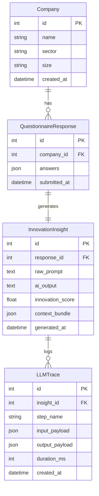

# CaForB — Current Implementation Specification (SPEC.md)

1
> **Document Version:** 2.0  
> **Project:** MSc Dissertation Prototype — *"The Role of Innovation in Driving Business Growth"*  
> **Author:** David Palhas | ISCTE-IUL, 2026  
> **Repository Context:** `DPalhas/CaForB`  
> **Last Updated:** August 2026  

---

## 1. System Overview

**CaForB** (Corporate Assessment for Business Innovation) is an AI-powered corporate decision-support system designed to evaluate an organization's innovation maturity, identify strategic growth opportunities, and generate concrete, budget-aware execution roadmaps.

The application captures rich corporate context across a 5-step structured assessment, formats the inputs into a prompt enriched with financial estimation and regulatory constraints, and processes the payload through a domain-aligned Large Language Model (Ollama local `gemma4` engine or fine-tuned LLM). The results are returned via GraphQL and rendered on an executive dashboard.

```
┌─────────────────────────┐      GraphQL      ┌──────────────────────────┐
│   Next.js App Router    │  ──────────────>  │   Django + Strawberry    │
│  (Tailwind CSS v4 + UI) │  <──────────────  │       GraphQL API        │
└─────────────────────────┘                   └────────────┬─────────────┘
                                                           │
                                                           ▼
                                              ┌──────────────────────────┐
                                              │   LLM Service (Ollama)   │
                                              │   Prompt Engine (Gemma4) │
                                              └──────────────────────────┘
```

---

## 2. Technology Stack

### 2.1 Backend (API & Engine)
- **Framework:** Django 6.0.6 (Python 3.12+)
- **GraphQL Layer:** Strawberry GraphQL (`strawberry-graphql-django`)
- **Database:** SQLite (Development) / PostgreSQL (Production)
- **CORS Management:** `django-cors-headers`
- **AI Integration:** Ollama Python SDK (`ollama.chat`) with model `gemma4`

### 2.2 Frontend (User Interface)
- **Framework:** Next.js 16.2.7 (App Router, Turbopack)
- **UI Library:** React 19.2.4 & TypeScript 5
- **Styling:** Tailwind CSS v4, custom glassmorphism, HSL color tokens, micro-animations
- **Iconography:** Lucide React (`lucide-react`)
- **GraphQL Client:** Apollo Client (`@apollo/client` v4)
- **UI Primitives:** `@base-ui/react` (Slider, Button), shadcn/ui, `tw-animate-css`

---

## 3. Database & Data Models (`core/models.py`)

The system uses four core relational models designed for complete auditability and agent-tracing readiness:



### Model Definitions
1. **`Company`**: Stores basic organizational parameters (`name`, `sector`, `size`).
2. **`QuestionnaireResponse`**: Stores the raw JSON payload submitted from all 5 survey sections.
3. **`InnovationInsight`**: Holds the AI-generated raw text output, parsed numeric `innovation_score`, and structured `context_bundle` (opportunities, execution plans, next steps, weaknesses).
4. **`LLMTrace`**: Records per-call metadata including step name, input payload, parsed output payload, and inference duration in milliseconds (`duration_ms`).

---

## 4. GraphQL API Architecture (`core/schema.py`)

**Endpoint:** `http://localhost:8000/graphql/`

### 4.1 Schema Types
```graphql
type ExecutionPlanType {
  firstActions: [String!]!
  resourcesNeeded: [String!]!
  successMetric: String!
  milestones: [String!]!
}

type OpportunityType {
  type: String!
  title: String!
  rationale: String!
  executionPlan: ExecutionPlanType
  impact: String!
  difficulty: String!
  timeframe: String!
}

type NextStepType {
  action: String!
  owner: String!
  timeframe: String!
}

type InsightType {
  id: Int!
  aiOutput: String!
  innovationScore: Float
  opportunities: [OpportunityType!]!
  nextSteps: [NextStepType!]!
  keyWeaknesses: [String!]!
}
```

### 4.2 Query & Mutation Contracts

#### Queries
- `health: String!`: System healthcheck (returns `"ok"`).
- `getInsight(id: Int!): InsightType`: Retrieves stored innovation insights by ID.

#### Mutations
- `submitQuestionnaire(companyName: String!, sector: String!, size: String!, answers: JSON!): InsightType!`:
  Creates `Company` and `QuestionnaireResponse` records, invokes `generate_innovation_insight`, parses structured JSON, stores `InnovationInsight` & `LLMTrace`, and returns the typed insight.

---

## 5. Prompt Engineering & AI Service (`core/services/llm_services.py`)

### 5.1 Financial Estimation & Budget Calibration
The backend calculates an annual estimated budget prior to prompt construction:
$$\text{Estimated Budget} = \text{Revenue Range Midpoint} \times \left(\frac{\text{Budget Percentage}}{100}\right)$$

- **Revenue Range Midpoints:**
  - `under_1m`: €500,000
  - `1m_to_10m`: €5,500,000
  - `10m_to_50m`: €30,000,000
  - `over_50m`: €75,000,000

### 5.2 Contextual Prompt Constraints
The prompt injects organizational parameters into strict generation rules:
1. **Regulatory Environment:** High regulation forces mandatory compliance/legal review steps and extends execution timeframes.
2. **Competitive Urgency:** High urgency biases opportunity mix toward at least one radical, high-impact proposal.
3. **Risk Appetite Alignment:**
   - *Conservative:* Generates exclusively incremental opportunities.
   - *Bold:* Mandates at least one radical opportunity.
   - *Balanced:* Mixes incremental and radical strategies evenly.
4. **Strategic Priorities:** Shapes opportunity focus:
   - *Growth:* Revenue expansion & market entry.
   - *Efficiency:* Cost reduction & automation.
   - *Market Defense:* Competitive moats & retention.
   - *Diversification:* New verticals & business models.

---

## 6. Frontend Structure & Application Flow (`frontend/app/`)

### 6.1 Page Routes
| Route | Component File | Description |
|-------|----------------|-------------|
| `/` | `app/page.tsx` | Hero landing page with feature cards & workflow overview |
| `/assessment` | `app/assessment/page.tsx` | 5-step interactive questionnaire & loading overlay |
| `/results/[id]` | `app/results/[id]/page.tsx` | Executive advisory dashboard & export view |

### 6.2 Assessment Workflow Data Model (`lib/types.ts`)

```typescript
export interface AssessmentFormData {
  // Section 1: Profile
  companyName: string;
  sector: string; // 26 industry sectors in dropdown
  size: CompanySize | "";
  regulatoryEnvironment: RiskLevel;
  companyDescription: string; // Required

  // Section 2: Innovation State
  innovationProcess: string;
  pastInitiatives: string;
  customerFeedback: string; // Required

  // Section 3: Strategic Goals & Risk
  strategicGoals: string;
  strategicPriority: StrategicPriority;
  timeHorizon: string;
  riskAppetite: RiskAppetite;

  // Section 4: Capabilities & Budget
  teamSize: string;
  digitalMaturity: string; // 4-level selector (Beginner to Advanced AI)
  revenueRange: RevenueRange;
  budgetPercentage: number; // Slider (0-30%)
  decisionMaking: string;

  // Section 5: Pain Points & Barriers
  mainBarrier: string[]; // Multi-select, 6 barrier types
  competitivePressure: RiskLevel;
  additionalContext: string;
}
```

### 6.3 UI Components Breakdown

#### Landing Page (`app/page.tsx`)
- Dark-mode background (`bg-slate-950`) with radial gradient overlays.
- Key metrics banner (`< 3 Mins`, `Fine-tuned AI`, `360° Roadmap`, `Enterprise Privacy`).
- Feature cards highlighting context-aware scoring, prioritized opportunities, and concrete execution plans.

#### Assessment Stepper (`app/assessment/components/StepIndicator.tsx`)
- Progress bar with gradient fill and percentage indicator.
- Step badges with distinct icons (`Building2`, `Compass`, `Target`, `Cpu`, `AlertTriangle`), glowing active rings, and checkmarks.

#### Analysis Overlay (`app/assessment/page.tsx`)
- Fullscreen backdrop blur with dual-ring spinning AI core indicator.
- Sequential loading step checklist ("Parsing profile...", "Evaluating digital maturity...", "Identifying opportunities...", "Synthesizing roadmap...").

#### Results Dashboard (`app/results/[id]/page.tsx`)
- **`ScoreCard.tsx`**: Radial SVG maturity gauge (0-10), level classification (*Early Stage*, *Developing*, *Established*, *Advanced Leader*), and progress benchmark scale.
- **`OpportunityCard.tsx`**: Ranked opportunity card with type pills (*Radical*, *Incremental*), impact, difficulty, timeframe badges, and expandable **Detailed Execution Roadmap** accordions (Immediate Actions, Required Resources, KPI Success Metric, Timeline Milestones).
- **`NextStepsList.tsx`**: Dark executive action cards with assigned owner badges and target timeframes.
- **`WeaknessesList.tsx`**: Warning cards highlighting identified operational bottlenecks.
- **Export Utility**: One-click `window.print()` PDF generation support.

---

## 7. Execution & Development Instructions

### 7.1 Backend Setup
```bash
# Activate virtual environment (Unix/macOS)
source .venv/bin/activate

# On Windows PowerShell:
.venv\Scripts\Activate.ps1

# Run migrations
python manage.py migrate

# Start Django development server
python manage.py runserver 8000
```
*GraphQL Endpoint available at:* `http://localhost:8000/graphql/`

### 7.2 Frontend Setup
```bash
cd frontend

# Install dependencies
npm install

# Run Next.js dev server
npm run dev
```
*Application available at:* `http://localhost:3000`

### 7.3 LLM Server (Ollama)
```bash
# Ensure Ollama is running
ollama serve

# Pull and verify model
ollama run gemma4
```

---

## 8. Verification & Test Suite

Production build verification passes with 0 lint and 0 type errors:
```bash
cd frontend
npm run build
```
**Output:**
```
✓ Compiled successfully
  Linting and checking validity of types ...
  Collecting page data ...
  Generating static pages (5/5) ...
  Finalizing page optimization ...
```

---

## 9. Design System & Obsidian Violet Color Palette

To elevate the application's corporate visual language, the interface is styled with a unified **"Obsidian Violet & Neon Indigo / Cyber Lavender Glow"** theme. This replaces the legacy teal/emerald color scheme with an extremely premium, high-contrast dark enterprise look across all views.

### 9.1 CSS Variables & Design Tokens (`app/globals.css`)
```css
:root {
  /* Deep obsidian navy/violet background */
  --background: oklch(0.12 0.025 260);
  --foreground: oklch(0.98 0.005 260);
  
  /* Glassmorphic card styling variables */
  --card: oklch(0.15 0.03 260 / 85%);
  --card-foreground: oklch(0.98 0.005 260);
  --popover: oklch(0.15 0.03 260);
  --popover-foreground: oklch(0.98 0.005 260);
  
  /* Core brand color accents */
  --primary: oklch(0.58 0.22 280);            /* Neon Orchid / Royal Purple */
  --primary-foreground: oklch(0.99 0 0);
  --secondary: oklch(0.18 0.03 260);
  --secondary-foreground: oklch(0.85 0.01 260);
  --muted: oklch(0.18 0.03 260);
  --muted-foreground: oklch(0.65 0.02 260);
  
  /* Interaction highlights */
  --accent: oklch(0.52 0.21 260);             /* Electric Indigo */
  --accent-foreground: oklch(0.99 0 0);
  --destructive: oklch(0.58 0.22 25);
  --border: oklch(0.22 0.03 260 / 60%);
  --input: oklch(0.16 0.03 260);
  --ring: oklch(0.62 0.16 280);               /* Cyber Lavender glow */
  --radius: 1rem;
}
```

### 9.2 Key Design Features
1. **Unified Obsidian Base**: The entire application (Landing Page, Assessment Form, Results Dashboard) runs on a deep space obsidian background (`--background`) with subtle radial glowing grids.
2. **Glassmorphism Overlay**: Questionnaire containers and results cards use a semi-transparent blur configuration (`backdrop-blur-xl bg-slate-900/60 border border-slate-800/80`) to achieve premium layered visual depth.
3. **High-Impact Gradient Highlights**: Important badges, charts, progress lines, and CTA buttons leverage a glowing gradient transitioning from Cyber Violet (`#c084fc`) through Neon Purple (`#a855f7`) to Royal Indigo (`#6366f1`).
4. **Contextual Metric Badges**:
   - *Radical / High Impact:* Cyber Violet / Purple glows.
   - *Incremental / Low Impact:* Neon Cyan / Sapphire Blue highlights.
   - *Weaknesses / Warnings:* Neon Amber / Orange alerts.

